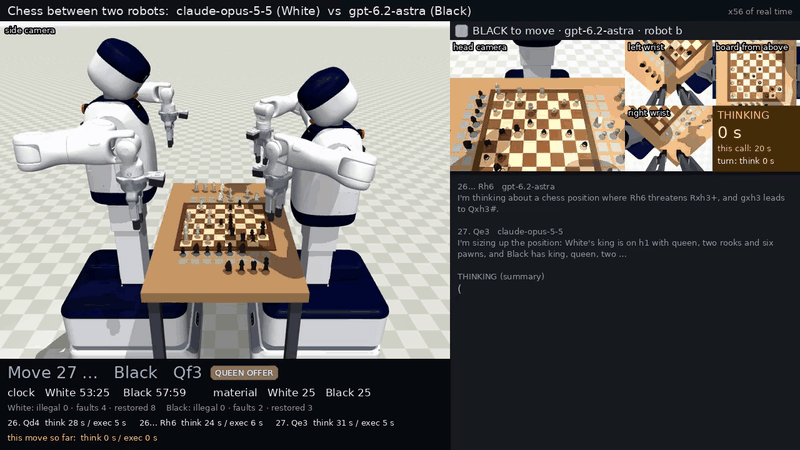

# omakase-bench

[English](README.md)

モデル名を指定するだけで、シミュレーション上でロボットタスクを実行し、採点済みのレポートまで出力します。

```sh
omakase-bench run --model anthropic/<model> --interface tools --suite core@1
```

このコマンドは、内容を固定して公開したスイート `core@1` の全タスクを 20 シードずつ MuJoCo で実行します。モデルはロボット API 経由でロボットを操作し、成否はシミュレータの真値（ground truth）だけで判定します（モデルの自己申告は採点に使いません）。結果は `results.json`、`report.html`、エピソードごとの動画として出力されます。

ベンチマークであると同時にフレームワークでもあります。URDF があればロボットを追加でき、パッケージを 1 つ追加すればタスクを増やせます。

## クイックスタート

```sh
git clone https://github.com/Omakase-Robotics-Org/omakase-bench && cd omakase-bench
uv sync                         # モデル用クライアントも入れる場合は --extra anthropic / --extra openai を付ける
uv run omakase-bench doctor     # 描画・動画・サンドボックス・API キー・クライアントライブラリの確認
```

Python 3.11 以上が必要です。描画は既定で `MUJOCO_GL=egl` を使います。EGL ドライバがない環境では `libOSMesa` と `PyOpenGL` を入れて `MUJOCO_GL=osmesa` を指定してください。

まずは最も単純なタスク `core/cube_to_tray`（キューブをつかんでトレイに置く）を動かしてみましょう。

```sh
# スクリプトによる模範解答。モデルも API キーも不要
uv run omakase-bench run --task core/cube_to_tray --model scripted/oracle --seeds 0-2

# 本物のモデルと同じインターフェースで動くダミーモデル。これもキー不要（表示される費用は名目上の値）
uv run omakase-bench run --task core/cube_to_tray --model mock/place --interface tools

# 実際のモデルで実行（クライアントライブラリ (uv sync --extra anthropic) と API キー (ANTHROPIC_API_KEY / OPENAI_API_KEY、または --env-file) が必要）
uv run omakase-bench run --task core/cube_to_tray --model anthropic/<model> --interface tools --seeds 0-2 --max-usd 2

# 同じタスクを別のロボットで
uv run omakase-bench run --task core/cube_to_tray --model scripted/oracle --robot arm6
```

実行ごとに `runs/<時刻>_<タスクまたはスイート>_<バックエンド>/` が作られ、`results.json` と `report.html` のほか、エピソードごとに `episodes/<subject>/<task>/<seed>/` 以下へ `trace.jsonl`、`result.json`、`episode.mp4` が出力されます。スイート・タスク・ロボット・バックエンドの一覧は `omakase-bench list` で確認できます。

## 基本概念

| | |
| --- | --- |
| **ロボット** | URDF と `robot.yaml`（腕、グリッパ、カメラ、台車、名前付き姿勢、各種制限）の組み合わせです。`robots/d1` は双腕のモバイルマニピュレータ、`robots/arm6` は直方体だけで構成した 6 軸アームです。ロボットの関節名が現れるのはこの記述だけで、ほかのコードには一切出てきません。 |
| **タスク** | `tasks/<family>/<task>/` のパッケージです。YAML の定義（シーン、シードごとに変える要素、指示文、成功条件、実行予算）と模範解答を持ちます。成否はシミュレータの真値で判定します。 |
| **スイート** | タスクとシードの一覧に名前とバージョンを付け、ハッシュで内容を固定したものです。結果を後から比較できるよう、公開後は変更しません。例: `core@1`、`manip@1`、`grip@1`、`team@1`、`games@1`。 |
| **インターフェース** | 評価対象（モデルやポリシー）がロボットを操作する方法です。`tools` は 1 ターンにロボット API を 1 回呼びます。`code` は同じ API を使うプログラムをモデルに書かせ、サンドボックスで実行します。`ee` はカメラ画像を見ながら指先の目標位置を 1 ステップずつ出力します。`chunks` は VLA ポリシー向けの関節アクションチャンク、`scripted` は模範解答です。 |
| **バックエンド** | 指令を実際に実行する部分です。MuJoCo（既定、CPU）、Isaac Sim、実機から選べます。リセットや真値を提供できるのはシミュレータだけなので、タスク側が必要な機能を宣言します。 |
| **ハーネス** | モデルとロボットの間に入る層です。ターンの進行、全指令が通る単一のロボット API、安全チェック、IK、観測の生成を担います。 |

## ロボットモデル

ロボットの記述は [`src/omakase_bench/robots/`](src/omakase_bench/robots/) にあり、ロボットごとにフォルダを分けています。

| ロボット | URDF | メッシュ | ベンチ用の設定 |
| --- | --- | --- | --- |
| D1（双腕、リフト、首、移動台車） | [`d1/d1.meshes.urdf`](src/omakase_bench/robots/d1/d1.meshes.urdf)（メッシュ付きの見た目）、[`d1/d1.urdf`](src/omakase_bench/robots/d1/d1.urdf)（基本形状のみ） | [`d1/meshes/`](src/omakase_bench/robots/d1/meshes/) | [`d1/robot.yaml`](src/omakase_bench/robots/d1/robot.yaml) |
| arm6（試験用の 6 軸アーム） | [`arm6/arm6.urdf`](src/omakase_bench/robots/arm6/arm6.urdf) | なし（直方体のみ） | [`arm6/robot.yaml`](src/omakase_bench/robots/arm6/robot.yaml) |

D1 の 2 つの URDF は、運動学と衝突形状が同じで、見た目だけが違います。D1 デーモンの API サブセットとカメラのインターフェース記述は [`d1/api/`](src/omakase_bench/robots/d1/api/) にあります。

## ドキュメント

- [docs/architecture.md](docs/architecture.md): 全体構成と、それを支えるインターフェース
- [docs/new_robot.md](docs/new_robot.md): URDF からロボットを追加する手順
- [docs/new_task.md](docs/new_task.md): タスクを追加する手順
- [docs/real_robot.md](docs/real_robot.md): 実機で動かす手順（安全ゲートと、シミュレーションとの違い）
- [docs/reference.md](docs/reference.md): コマンド、モデル、ロボット API、`ee` インターフェース、複数ロボットのタスク、バックエンド
- [docs/decisions.md](docs/decisions.md): 設計判断とその理由
- [docs/results/](docs/results/README.md): 実行結果の記録

ドキュメント本体は英語です。

## ショーケース: ロボット 2 台のチェス対局

`games/chess` では、2 台のロボットが 1 つの盤を挟み、それぞれ別のモデルが操作します。各モデルは指し手を審判に宣言し、カメラ画像を頼りに自分の腕で駒を動かします。審判は駒の位置を 1 つずつ確認し、持ち時間はモデルの思考中もロボットの動作中も減っていきます。

Claude Opus 5.5（白）と gpt-6.2-astra（黒）が MuJoCo 上で最後まで指した対局では、黒が 28 手でチェックメイトしました（`28. gxf3 Rxh3#`）。反則手は双方ゼロ、駒の配置ミスは白 5 回・黒 2 回でした。棋譜、解析、モデル別の数値は [docs/results](docs/results/README.md) にまとめています。



*終局の場面: 黒がクイーンを差し出し（`27... Qf3`）、白がそれを取り（`28. gxf3`）、黒がチェックメイトします（`28... Rxh3#`）。*

```sh
uv run omakase-bench run --task games/chess --seeds 0 --no-video      # スクリプト同士で「オペラ座の一局」を再現（CPU で数分、終了時に結果を表示）
```

## ライセンス

Apache License 2.0 です（`LICENSE`、`NOTICE`）。すべてのメッシュファイルについて、ハッシュ・出典・ライセンスを `assets.yaml` に記載しています。D1 デーモンの OpenAPI サブセットの出典は `src/omakase_bench/robots/d1/api/PROVENANCE.md` にあります。
