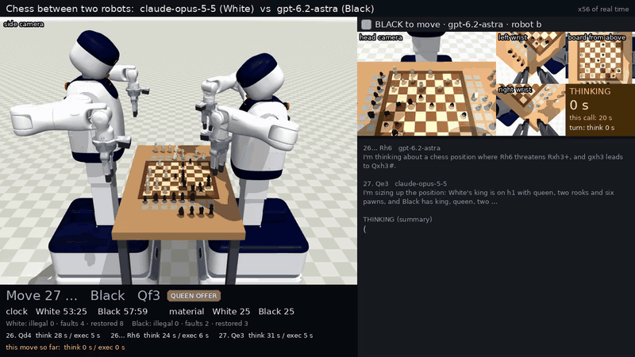

# Recorded results

Everything here was produced by `omakase-bench` on MuJoCo in lockstep time.

## Scripted reference solutions

The upper bound of each published suite: `omakase-bench run --model scripted/oracle --suite <suite> --no-video`
on the suites as published (`suites/frozen.yaml`).

| Suite | Tasks | The suite's own seeds | Seeds 0-29 |
| --- | --- | --- | --- |
| `core@1` | touch_cube, cube_to_tray, press_button | 60/60 (20 seeds) | |
| `manip@1` | chess_move, stack, sort, clutter_pick | 20/20 (5 seeds) | 120/120 |
| `grip@1` | packed_grid_pick | 5/5 | 29/30 (seed 21: a pad displaced a neighbour) |
| `team@1` | block_relay | 5/5 | 29/30 (seed 8: one block not placed in three turns) |
| `drafts@0` | elevator_call | 5/5 | |
| `games@1` | chess | see "Scripted players" below | |

## Chess between two robots (`games/chess`)

Two D1 robots at one board, one model per robot, the `ee` interface: each model sees its own cameras, names
its move to the referee and moves the pieces with its arms. No demonstrations.

### A game on `games@1` as published

The published rule: a position the referee has to restore takes 1 minute from the mover's clock, no number
of faults ends the game, and a robot has 4 replies to put right what the referee lists. White
`anthropic/claude-fable-5-2` (`effort=low`), Black `openai/gpt-6.2-astra` (`reasoning=medium`), played to
the end, nothing adjudicated.

| | |
| --- | --- |
| Result | 1-0, checkmate: `52. Qc5#` |
| Half-moves | 103 |
| Simulated time | 2946 s |
| Commit played on | `38830e7` (the tree of the first public release) |
| PGN | [chess_game5_fable52_vs_astra_games1.pgn](chess_game5_fable52_vs_astra_games1.pgn) |

| | White | Black |
| --- | --- | --- |
| Model | claude-fable-5-2 | gpt-6.2-astra |
| Moves | 52 | 51 |
| Illegal move attempts | 0 | 0 |
| Manipulation faults | 12 | 6 |
| Clock taken by fault penalties | 720 s | 360 s |
| Pieces knocked over | 7 | 6 |
| Pieces the referee restored | 17 | 8 |
| Corrections after "done" | 12 | 6 |
| Captures | 14 | 12 |
| Turns with a hand-over between the arms | 4 | 0 |
| Contacts between the robots | 0 | 0 |
| Thinking time (model calls) | 2537 s | 1852 s |
| Execution time (simulated) | 415 s | 363 s |
| Clock left of 3600 s + 30 s per move | 1487 s | 2555 s |
| Model calls | 656 | 573 |
| Input tokens (of which cached) | 4 311 969 (3 178 588) | 2 801 468 (1 999 129) |
| Output tokens | 164 268 | 23 891 |
| Cost | $16.82 | $8.57 |
| Average centipawn loss | 71.9 | 79.8 |
| Inaccuracies / mistakes / blunders | 1 / 5 / 8 | 3 / 4 / 6 |

Every one of the 18 corrections used all 4 replies and ended with the referee restoring the position, so
each became a fault. 85 of the 103 turns were valid. One robot touched a piece while returning to its
waiting pose (reported, not ruled).

The largest losses by the engine's count: for White `37. Nb3` (it prefers `Ne6`, 491 cp), `16. Kf1`
(`bxc3`, 410 cp), `34. Nc5` (`Nxg7`, 391 cp) and `38. Bc8` (`f6`, 388 cp); for Black `39... Re3+` (`Kc7`,
1101 cp), `28... Kb8` (`Ng4+`, 499 cp), `22... Rd1+` (`Rd3`, 470 cp) and `36... Kb6` (`Kd6`, 335 cp).
White promoted a pawn on move 45 and mated with king and queen.

### A game under the first manipulation-fault rule

Played under the first version of the rule (`docs/decisions.md`, D25): a position the referee has to
restore took 2 minutes from the mover's clock, a side's third such fault lost the game, and a robot had 4
replies to put right what the referee lists. The published rule takes 1 minute and sets no limit.
White `anthropic/claude-fable-5-2` (`effort=low`), Black `openai/gpt-6.2-astra` (`reasoning=medium`).

| | |
| --- | --- |
| Result | 0-1, loss by manipulation faults: White's third fault, on `14. Bxc4` |
| Half-moves | 27 |
| Simulated time | 769 s |
| Commit played on | `0933e4a` |
| PGN | [chess_game4_fable52_vs_astra_games1.pgn](chess_game4_fable52_vs_astra_games1.pgn) |

| | White | Black |
| --- | --- | --- |
| Model | claude-fable-5-2 | gpt-6.2-astra |
| Moves | 14 | 13 |
| Illegal move attempts | 0 | 0 |
| Manipulation faults (of 3) | 3 | 0 |
| Clock taken by fault penalties | 360 s | 0 s |
| Pieces knocked over | 1 | 0 |
| Pieces the referee restored | 7 | 0 |
| Corrections after "done" | 3 | 0 |
| Captures | 3 | 3 |
| Turns with a hand-over between the arms | 0 | 0 |
| Contacts between the robots | 0 | 0 |
| Thinking time (model calls) | 565 s | 318 s |
| Execution time (simulated) | 109 s | 81 s |
| Clock left of 3600 s + 30 s per move | 2986 s | 3591 s |
| Model calls | 176 | 126 |
| Input tokens (of which cached) | 1 114 110 (816 843) | 587 032 (417 434) |
| Output tokens | 36 643 | 3 531 |
| Cost | $4.15 | $1.76 |
| Average centipawn loss | 24.9 | 22.2 |
| Inaccuracies / mistakes / blunders | 0 / 0 / 1 | 1 / 1 / 0 |

White's three faults were on `4. Nxd4` (its g1 knight and e2 pawn restored), `7. Nb3` (the same knight and
the b2 pawn) and `14. Bxc4` (its bishop and two black pieces). Each time it said `done`, was told what
differed, used all 4 replies and left the position wrong. The position on the board was level when the
game ended (the engine's evaluation after `14. Bxc4`: +0.5 for White).

### A game before the fault rule

Played on the chess task before the manipulation-fault rule: a fault cost nothing but the referee's
restore, and a robot had 12 replies to correct a position. White `anthropic/claude-opus-5-5`
(`effort=low`), Black `openai/gpt-6.2-astra` (`reasoning=medium`), played to the end, nothing adjudicated.

| | |
| --- | --- |
| Result | 0-1, checkmate: `63... Qg3#` |
| Half-moves | 126 |
| Simulated time | 3595 s |
| Commit played on | `0e61f49` for the first 116 half-moves; the run's spending cap then stopped it, and it was resumed from the recorded position and clocks on `0ef3a23` for the last 10 |
| PGN | [chess_game3_opus55_vs_astra_games1.pgn](chess_game3_opus55_vs_astra_games1.pgn) |

Between the two commits only the resume of a game with a promotion changed (`58... h1=Q+` had been
played); the rules text, the referee's rulings and the prompts are the same.

| | White | Black |
| --- | --- | --- |
| Model | claude-opus-5-5 | gpt-6.2-astra |
| Moves | 63 | 63 |
| Illegal move attempts | 0 | 0 |
| Manipulation faults | 10 | 5 |
| Pieces knocked over | 9 | 11 |
| Pieces the referee restored | 17 | 12 |
| Corrections after "done" | 13 | 5 |
| Captures | 13 | 15 |
| Turns with a hand-over between the arms | 0 | 1 |
| Contacts between the robots | 0 | 0 |
| Thinking time (model calls) | 2767 s | 2199 s |
| Execution time (simulated) | 474 s | 457 s |
| Clock left of 3600 s + 30 s per move | 2249 s | 2834 s |
| Model calls | 802 | 733 |
| Input tokens (of which cached) | 5 249 224 (3 871 395) | 3 617 005 (2 570 977) |
| Output tokens | 180 845 | 27 183 |
| Cost | $10.24 | $10.99 |
| Average centipawn loss | 41.2 | 33.0 |
| Inaccuracies / mistakes / blunders | 7 / 6 / 4 | 5 / 4 / 3 |

In this game a robot told what differs after `done` had 12 more replies to correct it. Of the 18 corrections, 14 used
all 12 replies; the other four ended earlier.

The largest losses by the engine's count: for White `40. Nxe3` (it prefers `Kd3`, 249 cp), `15. Bd3`
(`h4`, 233 cp), `34. Ne4` (`Nc4`, 233 cp) and `30. Nd2` (`Na5`, 227 cp); for Black `39... e3+` (`Kf7`,
334 cp), `16... f5` (`Bxg5`, 323 cp) and `45... Kd6` (`Ke5`, 212 cp). The game ended with king, bishop
and a promoted queen against a bare king.

### Two earlier games

The two games below were played before the suites were frozen for the first public release (`docs/decisions.md`,
D25), on the commits named in the table, under the rules text and referee of those commits. The chess
task has changed since (among other things the allowance to correct a position is counted in replies), so
they are a record of those runs, not results on `games@1`. Costs are at the list prices in
`models/pricing.py` at the time of the run.

*Game 2, moves 27 to 28: Black offers the queen (`27... Qf3`), White takes it (`28. gxf3`), Black mates
(`28... Rxh3#`).*

| | Game 1 | Game 2 |
| --- | --- | --- |
| Commit played on | `95c0fd1` | `b9e29e4` |
| White (robot a) | anthropic/claude-opus-5-5, `effort=low` | anthropic/claude-opus-5-5, `effort=low` |
| Black (robot b) | openai/gpt-6.2-astra, `reasoning=medium` | openai/gpt-6.2-astra, `reasoning=medium` |
| Rule set | cut off after 40 moves per side, adjudicated by material | played to the end, nothing adjudicated |
| Result | 0-1, by material (White 3, Black 6) | 0-1, checkmate: `28. gxf3 Rxh3#` |
| Half-moves | 80 | 56 |
| Simulated time | 2320 s | 1583 s |
| PGN | [chess_game_opus55_vs_astra.pgn](chess_game_opus55_vs_astra.pgn) | [chess_game2_opus55_vs_astra_mate.pgn](chess_game2_opus55_vs_astra_mate.pgn) |

#### Per model

| | Game 1 White | Game 1 Black | Game 2 White | Game 2 Black |
| --- | --- | --- | --- | --- |
| Model | claude-opus-5-5 | gpt-6.2-astra | claude-opus-5-5 | gpt-6.2-astra |
| Moves | 40 | 40 | 28 | 28 |
| Illegal move attempts | 0 | 0 | 0 | 0 |
| Manipulation faults | 10 | 3 | 5 | 2 |
| Pieces knocked over | 12 | 3 | 7 | 3 |
| Pieces the referee restored | 20 | 5 | 11 | 3 |
| Corrections after "done" | 11 | 4 | 5 | 2 |
| Captures | 11 | 12 | 7 | 7 |
| Turns with a hand-over between the arms | 3 | 1 | 1 | 0 |
| Contacts between the robots | 0 | 0 | 0 | 0 |
| Thinking time (model calls) | 1976 s | 1332 s | 1130 s | 808 s |
| Execution time (simulated) | 327 s | 312 s | 205 s | 200 s |
| Clock left of 3600 s + 30 s per move | 2497 s | 3155 s | 3106 s | 3432 s |
| Model calls | 533 | 483 | 331 | 300 |
| Input tokens (of which cached) | 3 440 960 (2 532 755) | 2 344 484 (1 671 884) | 2 093 425 (1 536 587) | 1 421 383 (1 011 237) |
| Output tokens | 126 678 | 18 338 | 69 779 | 10 587 |
| Cost | $6.88 | $7.08 | $4.07 | $4.32 |

A manipulation fault is a turn that ended with a piece out of place; the referee puts it right and the
game goes on.

#### Centipawn loss

From `omakase-bench chess cpl <pgn> --engine <stockfish>` with a Stockfish release build (evaluations held within ±1000 cp,
so one move loses at most 2000 cp).

| | Game 1 White | Game 1 Black | Game 2 White | Game 2 Black |
| --- | --- | --- | --- | --- |
| Average centipawn loss | 40.8 | 25.7 | 92.2 | 56.0 |
| Inaccuracies (50-99 cp) | 1 | 3 | 0 | 0 |
| Mistakes (100-199 cp) | 4 | 3 | 0 | 0 |
| Blunders (200 cp or more) | 1 | 1 | 2 | 2 |

Game 2 was decided in its last three moves: `26... Rh6` (the engine prefers `Rxg2`, 609 cp), `27... Qf3`
(prefers `Rhg6`, 801 cp), which offers the queen, and `28. gxf3` (prefers `Qxg5`, 1755 cp), which takes
it and allows `28... Rxh3#`.

### Scripted players

`omakase-bench run --task games/chess --seeds 0-2 --no-video` replays three recorded lines with the
scripted player on both robots: the Opera Game (33 of 33 turns valid, checkmate, no fault), a line with
en passant, promotion with capture and castling on both sides (31 moves and the closing turn, all valid, no fault), and a line with
hand-overs between the arms. `omakase-bench chess tour a out.json` carries a king to every square and
capture slot: 80 of 80 placements for each robot, no contact between the robots.
